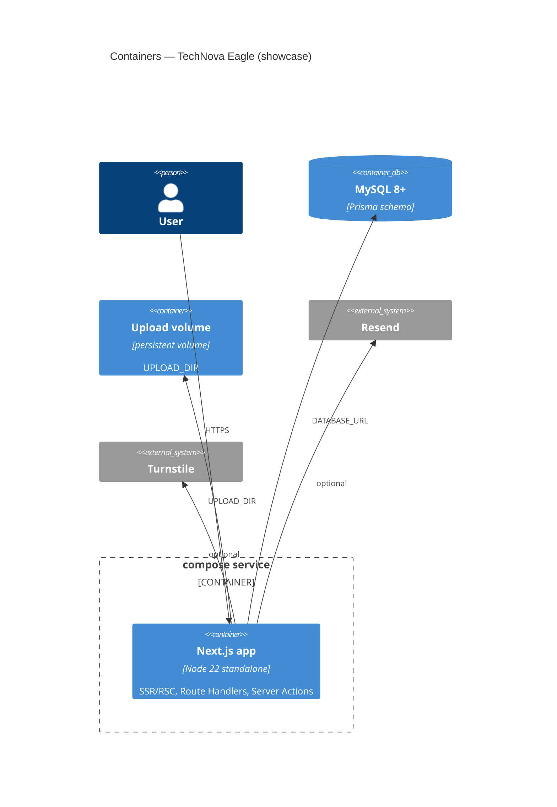

# TechNova Eagle — Web Case Study (public showcase)

Public portfolio repository that documents the **quality system** behind [technova-eagle.com](https://technova-eagle.com) **without publishing the application source**.

> **All rights reserved** — see [LICENSE](./LICENSE). Readable for employers; not reusable as a starter kit.

---

## Kurzüberblick (DE)

Mehrsprachige Unternehmenswebsite für **TechNova Eagle** (Live: [technova-eagle.com](https://technova-eagle.com)). Rolle: **Architekt und Lead-Entwickler**. Stack: Next.js 16, React 19, TypeScript, Prisma/MySQL, iron-session, Zod, Vitest, Playwright. Ergebnisse u. a.: **159** Tests (142 Unit+Integration, 17 E2E, 100 % grün), **52,86 %** kombinierte Line-Coverage (vorher 40,66 %), Pipeline `#3085809308`, manuelles GitLab-CI mit lokalem `pnpm verify`, Security-Härten (Honeypot, Upload-Sniff, `APP_ENV`), WCAG-Prüfung (axe), Performance-Arbeit unter Design-Schutz. Dieses Repo enthält dokumentierte Architektur, ADRs, Konzepte und 4 Code-Ausschnitte — **keinen** produktiven Quellcode.

---

## What this is

Multilingual corporate site for **TechNova Eagle** — software and digital solutions: marketing (services, work, industries, markets, insights), lead generation (consultation + partnerships), careers, public tracking portals, and an authenticated admin area on MySQL.

- **Live:** https://technova-eagle.com  
- **Locales:** `en` (default), `ar` (RTL), `de`  
- **My role:** Architect and lead developer (architecture, CI/quality, security hardening, performance under design constraints, documentation)

This showcase is intentionally **docs-first**. The private product repo stays private.

---

## Tech stack

Versions from the product `package.json` / `packageManager` / Docker image.

| Layer | Choice | Version |
| --- | --- | --- |
| Package manager | pnpm | 12.6.0 |
| Runtime (Docker) | Node.js | 22 |
| Framework | Next.js (App Router, standalone) | 16.4.6 |
| UI | React / React DOM | 19.2.8 |
| Language | TypeScript | ^5 |
| Styling | Tailwind CSS | ^4 |
| ORM / DB | Prisma + MySQL | Prisma 6.19.3 |
| Auth sessions | iron-session | ^9.0.1 |
| Password hashing | bcryptjs | ^3.0.3 |
| Validation | Zod | ^4.6.5 |
| Motion | Motion, GSAP | ^13.4.4 / ^3.15.0 |
| 3D | three, R3F, drei, postprocessing | (lazy client islands) |
| Unit / integration | Vitest | ^5.1.0 |
| E2E | Playwright | ^1.63.0 |
| A11y automation | @axe-core/playwright | ^4.14.0 |
| Lint | ESLint + eslint-config-next | ^9 / 16.4.6 |

Content: typed TypeScript modules (`src/content/**`). UI: custom components (not shadcn/Radix).

---

## Key results

| Area | Fact |
| --- | --- |
| Tests | **159** automated tests — **142** unit + integration, **17** e2e; **100%** passing (pipeline `#3085809308`) |
| Coverage | **52.86%** combined line coverage (`src/lib/**` + `src/server/**`); was **40.66%** before the testing work |
| CI design | Manual GitLab pipelines + local `pnpm verify`; combined MySQL coverage job — see [ci/](./ci/) |
| Security | Honeypot discarded flow, file content↔extension sniff, `APP_ENV`, headers (partial CSP), rate limits, Turnstile |
| Accessibility | WCAG 2.2 AA statement; axe suite; known visual limits: `color-contrast`, `target-size` |
| Performance | Mobile Lighthouse floors in CI; `/en` LCP ~1.2 s; `/ar`/`/de` stop rule still open; Arabic font preload tested and **reverted** |

---

## How I work

Development under explicit project rules:

- **Design protection** — visual identity is a business asset; no silent regressions for perf/a11y/refactors ([design-protection.md](./docs/engineering-rules/design-protection.md))
- **Project rules** — no silent outbound telemetry; no secret logging ([project.md](./docs/engineering-rules/project.md))
- **Test-first bug fixes** — e.g. honeypot persistence caught by failing integration cases before the `discarded` fix
- **Small reversible commits** — including explicit reverts when experiments fail the design bar (Arabic font preload)

---

## C4 container diagram

Full architecture: [docs/architecture/arc42.md](./docs/architecture/arc42.md).

---

## Repository map

| Path | Contents |
| --- | --- |
| [docs/architecture/arc42.md](./docs/architecture/arc42.md) | arc42 architecture |
| [docs/adr/](./docs/adr/) | ADRs 0001–0008 |
| [docs/testkonzept.md](./docs/testkonzept.md) | Test concept |
| [docs/sicherheitskonzept.md](./docs/sicherheitskonzept.md) | Security concept |
| [docs/iso-alignment.md](./docs/iso-alignment.md) | ISO alignment (not certification) |
| [docs/barrierefreiheit.md](./docs/barrierefreiheit.md) | Accessibility (WCAG) |
| [docs/performance/results.md](./docs/performance/results.md) | Mobile Lighthouse results |
| [docs/engineering-journey.md](./docs/engineering-journey.md) | Problem → action → result by phase |
| [docs/domain-model.md](./docs/domain-model.md) | Entities & relations (no sensitive fields) |
| [docs/i18n-content-architecture.md](./docs/i18n-content-architecture.md) | Typed content, locales, RTL, SEO |
| [docs/engineering-rules/](./docs/engineering-rules/) | Design protection + project rules |
| [ci/](./ci/) | Sanitized GitLab CI + design notes |
| [code-samples/](./code-samples/) | Four short excerpts only |
| [evidence/](./evidence/) | Placeholder for screenshots you add |
| [LICENSE](./LICENSE) | All rights reserved |

---

## What is not here

Private product source, operations runbooks, deploy notes, env files, seed/admin scripts, geo content drafts, CHANGELOG, CONTRIBUTING, CI configs beyond the sanitized GitLab file, and other internal templates. See the private product repository.
