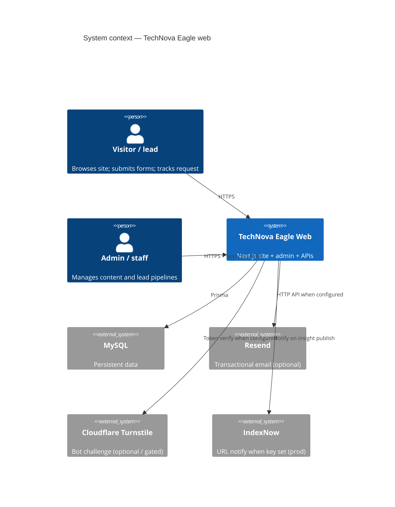
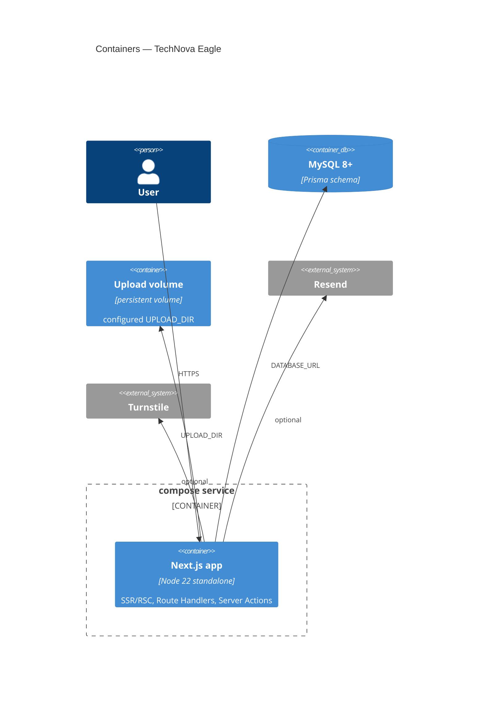

# TechNova Eagle — Architecture (arc42)

Source of truth for durable architecture (showcase / sanitized). Prefer the private codebase when docs conflict. Unknowns are marked **Open**.

---

## 1. Introduction and goals

### 1.1 Purpose

Multilingual corporate website for TechNova Eagle: marketing (services, work, industries, process, about, markets, insights), lead generation (consultation + partnerships), careers, public tracking portals, and an authenticated admin area backed by MySQL.

### 1.2 Quality goals

| Priority | Goal                         | Rationale (from product/docs)                                      |
| -------- | ---------------------------- | ------------------------------------------------------------------ |
| 1        | SEO / discoverability        | Metadata, JSON-LD, sitemap, robots, llms.txt, optional IndexNow    |
| 2        | Design integrity             | Visual identity is a business asset; no silent visual regressions  |
| 3        | i18n + Arabic RTL            | Locales `en` / `ar` / `de`; RTL for `ar`                           |
| 4        | Performance with enhancement | Server-first; motion/3D progressive; keep copy in HTML             |
| 5        | Security of forms & admin    | Rate limits, honeypot, Turnstile, session cookies, file validation |

### 1.3 Stakeholders

| Stakeholder        | Interest                                               |
| ------------------ | ------------------------------------------------------ |
| Site visitors      | Services, trust, contact / consultation                |
| Leads / partners   | Submit requests; track status via public ID; file downloads via access password |
| Applicants         | Apply to job openings                                  |
| Admin / staff      | Manage insights, careers, consultations, partnerships  |
| Operators / devops | Docker + MySQL deploy, migrations, env config          |
| Developers         | Typed content, small client surface, CI quality gates  |

---

## 2. Constraints

- **Stack:** Next.js 16 App Router, React 19, TypeScript, Tailwind CSS 4, Prisma 6 + MySQL, iron-session, Zod, pnpm.
- **Hosting shape:** Docker standalone image + compose; not Vercel-centric in-repo.
- **Locales:** Prefixed routes (`/en`, `/ar`, `/de`); default `en`; locale redirect in `src/proxy.ts` (not `middleware.ts`).
- **Content:** Typed TypeScript modules under `src/content/**` — no MDX / CMS in tree.
- **UI:** Custom `src/components/ui/*` — not shadcn/Radix.
- **Design protection:** Colors, motion, 3D, copy, RTL must not change without explicit approval (`docs/engineering-rules/design-protection.md`).
- **CI:** GitLab CI/CD on merge requests and the default branch (quality, integration coverage, e2e, Docker, Lighthouse floors).
- **Secrets:** No secrets via `NEXT_PUBLIC_*`; `SESSION_SECRET` required for sessions.
- **Optional DB:** Marketing site can boot without MySQL (`DATABASE_OPTIONAL` / placeholder URL).

---

## 3. Context and scope

### 3.1 Business context

Public users browse marketing pages and submit consultation / partnership / career forms. Successful consultation/partnership creates a trackable record. Admins authenticate and manage DB-backed entities. Optional Resend email and Cloudflare Turnstile when configured.

### 3.2 Technical context (C4 system context)

### 3.3 Scope

**In scope:** Public locale site, admin UI, tracking portals, API routes under `src/app/api/**`, Prisma domains listed in §5, SEO helpers, Docker deploy path.

**Out of scope / not present:** MDX pipeline, external headless CMS, full CSP policy, analytics implementation beyond env stub, automatic CI on every push.

---

## 4. Solution strategy

- **Server Components first;** Client Components for navigation, forms UX, motion, canvas/3D.
- **Typed content modules + getters** instead of MDX for compile-time safety and no content toolchain.
- **Prisma + MySQL** for admin users, insights, careers, consultations, partnerships; safe fallbacks when DB optional.
- **iron-session** cookies: `tn_admin_session` and `tn_tracking_session` (not a full IdP).
- **Locale prefixing** via App Router `[locale]` + `src/proxy.ts` 308 to default locale.
- **Defense in depth on forms:** honeypot → in-memory rate limit → Turnstile (where enabled) → Zod → persist.
- **Uploads:** `validateAndStoreFile` — extension must match sniffed content; stored under configured upload root.
- **Cache:** `revalidatePath` after admin mutations (insights, careers, consultations, partnerships); optional IndexNow on published insights.
- **Deploy:** multi-stage Docker image, entrypoint `prisma migrate deploy` (fail closed), volume for uploads.

---

## 5. Building block view

### 5.1 Level 1 — Containers

### 5.2 Level 2 — Inside the Next.js app

| Building block                          | Responsibility                                                             |
| --------------------------------------- | -------------------------------------------------------------------------- |
| `src/app/[locale]/**`                   | Public pages, admin UI, consultation/partnership portals                   |
| `src/app/api/**`                        | Consultation, partnership, admin-login, create-account, media, admin files |
| `src/proxy.ts`                          | Redirect paths without locale prefix to `/{defaultLocale}/…`               |
| `src/content/**` + `src/lib/content/**` | Typed catalogs and getters                                                 |
| `src/lib/seo/**`, `structured-data/**`  | Metadata, canonical/hreflang, JSON-LD, llms, IndexNow                      |
| `src/lib/validation/**`                 | Zod schemas + in-memory rate limit                                         |
| `src/lib/security/**`                   | Turnstile, `APP_ENV` / production detection, admin bootstrap gate          |
| `src/lib/consultation` / partnerships / careers | Form processing (honeypot, RL, Turnstile, Zod, email)              |
| `src/server/auth/**`                    | iron-session admin + tracking; bcrypt passwords; guards                    |
| `src/server/db/**`                      | Prisma client + optional-DB safe wrappers                                  |
| `src/server/files/**`                   | Validate + store uploads                                                   |
| `src/server/modules/**`                 | Domain server actions (insights, careers, consultations, partnerships)     |
| `src/components/**`                     | Layout, sections, forms, admin UI, tracking UI, 3D (lazy)                  |
| `prisma/`                               | Schema, migrations                                                         |

---

## 6. Runtime view

### 6.1 Consultation submission + tracking portal

1. Client posts `FormData` to `POST /api/consultation`.
2. `processConsultationRequest`: if honeypot `website` filled → `discarded` (API returns fake **success**, no persist/email).
3. Else: rate limit by IP → Turnstile verify → Zod → optional Resend delivery.
4. On success: persist stores bcrypt `accessPasswordHash` plus plaintext `accessPassword` for admin share-only → JSON with `redirectTo` `/{locale}/consultations/{publicId}` (no auto-unlock; password not returned to the submitter).
5. Portal page: status / meeting / complete-details / feedback are visible without a password. File downloads require the access password → verify access action → `grantTrackingAccess` (files only) → tracking file API routes.

Partnership flow is analogous (`/api/partnership`, `/partnerships/status/{publicId}`).

### 6.2 Admin login

1. `POST /api/admin-login` with email/password/locale.
2. Rate limit `admin-login:{ip}` (10 / 15 min).
3. Lookup `User`, verify password (bcryptjs); role must be `admin` or `staff`.
4. Save iron-session `tn_admin_session` (`userId`, `role`, `name`, `email`).
5. JSON redirect to `/{locale}/admin`. Subsequent `/admin/*` uses admin session guards.

### 6.3 Locale routing

1. Request hits `src/proxy.ts` matcher (excludes `api`, static, files with extensions, sitemap/robots).
2. If pathname already has `/en|ar|de` → continue.
3. Else 308 redirect to `/{defaultLocale}` or `/{defaultLocale}{pathname}`.
4. App Router `[locale]` layout sets `lang` / `dir` (`ar` → RTL).

### 6.4 Insight publish with revalidation

1. Admin submits create/update (requires admin session).
2. Optional image via `validateAndStoreFile(..., "image")`.
3. Prisma write; `publishedAt` set when status is `published`.
4. `revalidatePath` for locale insights listing, RSS, admin insights.
5. If published: IndexNow notify when configured (no-op without key / non-prod rules).

---

## 7. Deployment view

### 7.1 Docker Compose (shape)

- **Service `web`:** multi-stage standalone Next.js image; `NEXT_PUBLIC_SITE_URL` as **build arg** (inlined) and runtime env.
- **Volume:** uploads mounted to configured `UPLOAD_DIR`.
- **Restart:** `unless-stopped`.
- **Entrypoint:** `prisma migrate deploy` (fail closed unless explicitly skipped); then Node server.

MySQL is typically external to the compose file (via `DATABASE_URL`).

### 7.2 Environment variables (selected)

| Variable                                                      | Role                                                                                                                     |
| ------------------------------------------------------------- | ------------------------------------------------------------------------------------------------------------------------ |
| `APP_ENV`                                                     | `development` \| `test` \| `production` for fail-closed security paths; falls back to `NODE_ENV` / site URL with warning |
| `NEXT_PUBLIC_SITE_URL`                                        | Absolute origin; must be correct at **image build**                                                                      |
| `DATABASE_URL`                                                | MySQL connection                                                                                                         |
| `DATABASE_OPTIONAL`                                           | Allow boot without DB                                                                                                    |
| `SESSION_SECRET`                                              | iron-session password (≥ 32 chars)                                                                                       |
| `UPLOAD_DIR`                                                  | Upload root                                                                                                              |
| `ALLOW_ADMIN_BOOTSTRAP`                                       | Gates public create-account                                                                                              |
| `RESEND_*` / `CONTACT_*`                                      | Email (optional)                                                                                                         |
| `NEXT_PUBLIC_TURNSTILE_SITE_KEY` / `TURNSTILE_SECRET_KEY`     | Turnstile                                                                                                                |
| `TURNSTILE_PARTNERSHIP_ENABLED` / `TURNSTILE_CAREERS_ENABLED` | Per-form Turnstile (default off)                                                                                         |
| `INDEXNOW_KEY`                                                | IndexNow + rewrite to key `.txt`                                                                                         |

---

## 8. Crosscutting concepts

### 8.1 i18n and RTL

Locales in `src/types/locale` / `src/lib/i18n`; dictionaries and content getters per locale; `getDirection("ar") === "rtl"`. See [i18n-content-architecture.md](../i18n-content-architecture.md).

### 8.2 SEO / GEO structured data

`src/lib/seo/*` (metadata, canonical, hreflang, llms) and `src/lib/structured-data/*` (Organization, WebPage, Article, FAQ, JobPosting, …). `sitemap.ts`, `robots.ts`, `llms.txt` / `llms-full.txt`.

### 8.3 Security

- **Headers:** HSTS (short max-age), nosniff, Referrer-Policy, CSP **`frame-ancestors 'none'` only** (no full CSP), Permissions-Policy locking unused APIs; noindex on admin/API/portals/create-account.
- **Honeypot:** non-empty `website` → discarded + fake success.
- **Turnstile:** consultation always verified via helper; partnership/careers optional via env flags.
- **File validation:** MIME sniff must match extension (`validateAndStoreFile`); reject code `type` on mismatch.
- **Sessions:** httpOnly cookies; secure in production `NODE_ENV`.

### 8.4 Validation

Zod schemas under `src/lib/validation/**` for forms/API payloads.

### 8.5 Error handling

API routes return structured JSON `{ status, code?, message? }` with HTTP 4xx/5xx; server actions return action state objects; Prisma/DB errors logged; optional DB paths return empty/static fallbacks.

### 8.6 Design protection

Workspace rule: no visual/token/motion/3D/copy/RTL changes without explicit approval; performance work must preserve final pixels.

---

## 9. Architecture decisions

ADRs (MADR) in [`docs/adr/`](../adr/):

| ADR                                                   | Title                                        |
| ----------------------------------------------------- | -------------------------------------------- |
| [0001](../adr/0001-typescript-content-modules.md)     | TypeScript content modules instead of MDX    |
| [0002](../adr/0002-iron-session-auth.md)              | iron-session instead of a full auth provider |
| [0003](../adr/0003-prisma-data-layer.md)              | Prisma as data layer                         |
| [0004](../adr/0004-locale-routing-proxy.md)           | Locale routing in `proxy.ts`                 |
| [0005](../adr/0005-server-first-client-islands.md)    | Server-first rendering with client islands   |
| [0006](../adr/0006-honeypot-fake-success.md)          | Honeypot discarded but fake success          |
| [0007](../adr/0007-file-content-matches-extension.md) | File content must match extension            |

Cross-cutting docs: [testkonzept](../testkonzept.md), [sicherheitskonzept](../sicherheitskonzept.md), [iso-alignment](../iso-alignment.md) (alignment only, not certification), [barrierefreiheit](../barrierefreiheit.md), [seo-geo-architecture](../seo-geo-architecture.md), [engineering-journey](../engineering-journey.md).

---

## 10. Quality requirements

Quality/test planning detail: [docs/testkonzept.md](../testkonzept.md). ISO mapping summary: [docs/iso-alignment.md](../iso-alignment.md).

### 10.1 Quality tree (ISO/IEC 25010 mapping)

- **Functional suitability** — Lead forms persist + tracking; admin CRUD; marketing content correct per locale.
- **Performance efficiency** — LCP-conscious image/canvas boot; lab floors in CI Lighthouse job; Arabic/DE LCP stop rule not yet met (see §11).
- **Compatibility** — Modern browsers; RTL layout for `ar`.
- **Usability / accessibility** — Semantic HTML for hero copy; reduced-motion respected for enhancement; **Open:** full a11y score targets.
- **Reliability** — Migrate deploy fail-closed; optional DB for marketing-only boot.
- **Security** — Sessions, rate limits, honeypot, Turnstile, upload sniffing, security headers (partial CSP).
- **Maintainability** — Typed content, Vitest + Playwright, CI quality gates, Prettier/ESLint.
- **Portability** — Docker standalone on Node 22.

### 10.2 Scenarios

| ID  | Scenario                                | Measure                                                                                                 | ISO characteristic                   |
| --- | --------------------------------------- | ------------------------------------------------------------------------------------------------------- | ------------------------------------ |
| Q1  | Submit consultation as human            | 200 + redirect to portal; row in DB                                                                     | Functional suitability               |
| Q2  | Bot fills honeypot                      | HTTP success-shaped response; **no** DB row / email                                                     | Security                             |
| Q3  | Publish insight                         | Listing/RSS paths revalidated; IndexNow when configured                                                 | Functional + Performance (freshness) |
| Q4  | CI quality job                          | format + lint + typecheck pass                                                                          | Maintainability                      |
| Q5  | Docker start with bad migration history | Container exits (migrate deploy fails)                                                                  | Reliability                          |
| Q6  | Mobile LCP floors                       | CI `perf:ci` floor assertions; medians documented in `docs/performance/`                                | Performance efficiency               |
| Q7  | Visual identity                         | Design-protection rule; local visual review — **Open:** automated screenshot gate in CI removed         | Maintainability / Usability          |

---

## 11. Risks and technical debt

| Item                                                  | Status            | Notes                                                                                                     |
| ----------------------------------------------------- | ----------------- | --------------------------------------------------------------------------------------------------------- |
| In-memory rate limit (`Map` in process)               | **Accepted risk** | Resets on restart; not shared across instances                                                            |
| No full CSP                                           | **Open**          | Only `frame-ancestors 'none'`; js-class script documents future hash/nonce                                |
| MySQL as sole DB                                      | **Accepted**      | Operational coupling to MySQL                                                                             |
| Arabic font / `/ar` LCP                               | **Open**          | Preload approach reverted (competed with LCP image + metric drift); lab stop rule unmet on `/ar` (~4.9 s) |
| Dead code: unused consultation action helper          | **Open**          | UI posts to `/api/consultation`                                                                           |
| File serve trusts stored extension for `Content-Type` | **Open**          | Sniff at upload; media routes do not re-sniff                                                             |
| Playwright CI image Node 24 vs app Node 22            | **Open**          | Documented as known mismatch                                                                              |

---

## 12. Glossary

| Term              | Definition                                                                   |
| ----------------- | ---------------------------------------------------------------------------- |
| arc42             | Architecture documentation template used by this doc                         |
| ADR / MADR        | Architecture Decision Record (Markdown ADR format)                           |
| App Router        | Next.js file-system router under `src/app`                                   |
| RSC               | React Server Component (default on server)                                   |
| Client island     | Client Component subtree hydrated for interactivity                          |
| Locale prefix     | First path segment `en` \| `ar` \| `de`                                      |
| Tracking portal   | Public status page; file downloads unlocked by iron-session after password   |
| Honeypot          | Hidden form field (`website`); bots fill it → discarded                      |
| Turnstile         | Cloudflare bot challenge token verification                                  |
| `APP_ENV`         | Explicit runtime environment for security fail-closed paths                  |
| GEO               | Generative-engine / AI discovery content practices (llms.txt, entity)        |
| IndexNow          | Protocol to notify search engines of URL changes                             |
| Design protection | Rule forbidding silent visual/design regressions                             |
