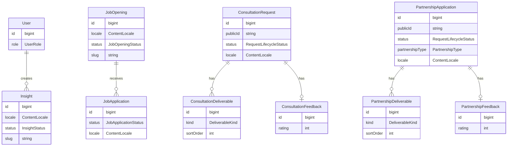

# Domain model (entities & relations)

Sanitized ER view of the Prisma schema. Field lists omit sensitive columns (PII payloads, password hashes, file passwords, admin notes). Relations and lifecycle statuses only.

## Enums (names only)

| Enum | Values |
| --- | --- |
| `UserRole` | `admin`, `staff` |
| `ContentLocale` | `ar`, `en`, `de` |
| `InsightStatus` | `draft`, `published` |
| `JobOpeningStatus` | `open`, `closed`, `draft` |
| `JobApplicationStatus` | `new`, `reviewing`, `shortlisted`, `rejected`, `hired` |
| `RequestLifecycleStatus` | `under_review`, `contacted`, `in_progress`, `completed` |
| `PartnershipType` | `representation`, `agency` |
| `DeliverableKind` | `study`, `implementation`, `documentation`, `delivery`, `guide`, `other` |

## Notes

- Tracking portals unlock via a separate iron-session cookie after verifying a hashed access password on the request/application row (not shown as an entity).
- Marketing content (services, markets, case studies) lives in typed TypeScript modules, not in MySQL — see [i18n-content-architecture.md](i18n-content-architecture.md).
