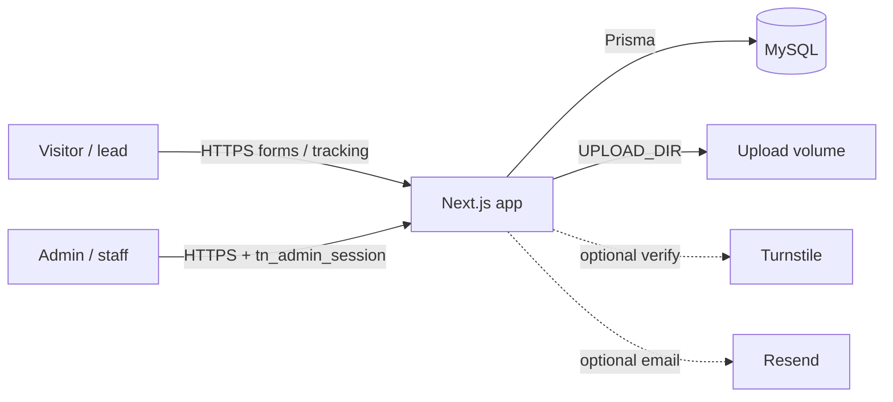

# Security concept (Sicherheitskonzept)

Evidence from code, ADRs, tests, and arc42 only. Gaps marked **Open**. Not a certification claim.

Related: [arc42 §11](architecture/arc42.md#11-risks-and-technical-debt), [ADR 0002](adr/0002-iron-session-auth.md), [0006](adr/0006-honeypot-fake-success.md), [0007](adr/0007-file-content-matches-extension.md), [iso-alignment.md](iso-alignment.md).

---

## 1. Assets and trust boundaries

**Assets**

| Asset                     | Location / notes                                         |
| ------------------------- | -------------------------------------------------------- |
| Lead PII + form payloads  | MySQL (consultation, partnerships, careers)              |
| Tracking access passwords | bcrypt hash + admin-only plaintext; unlocks file downloads only |
| Admin credentials         | `User` table; `SESSION_SECRET` seals cookies             |
| Uploaded files            | Configured `UPLOAD_DIR` / Docker upload volume           |
| Session cookies           | `tn_admin_session`, `tn_tracking_session` (iron-session) |
| Optional API keys         | Resend, Turnstile secret, IndexNow (env only)            |

**Trust boundaries**

- Browser ↔ Next.js (public HTTPS)
- Next.js ↔ MySQL (`DATABASE_URL`)
- Next.js ↔ filesystem uploads
- Next.js ↔ Cloudflare Turnstile / Resend / IndexNow (optional outbound)

---

## 2. STRIDE (short)

| Surface             | Spoofing                         | Tampering                 | Repudiation       | Info disclosure                                     | DoS                            | Elevation                            |
| ------------------- | -------------------------------- | ------------------------- | ----------------- | --------------------------------------------------- | ------------------------------ | ------------------------------------ |
| Public forms        | Honeypot + optional Turnstile    | Zod + server validation   | DB row + email    | No password in JSON responses (integration asserts) | In-memory rate limit (5/h/key) | N/A (no auth)                        |
| Tracking portal     | Status public by UUID; files need password + cookie | Attachment validate/store | Portal actions    | noindex layouts; password not auto-shown to lead | Rate limit on unlock paths     | Cookie unlock ≠ admin; file routes scoped to request |
| Admin login/session | bcrypt + iron-session            | Session sealed            | Login API         | Admin noindex + redirect                            | **Open** dedicated login RL    | Admin session guards                 |
| File upload/serve   | Sniff match extension (ADR 0007) | Reject type/large/missing | Stored path in DB | Media `nosniff`; **Open:** serve trusts stored ext  | Size caps per kind             | Admin file routes need admin session |

---

## 3. OWASP ASVS 4.0.3 Level 1 (selected)

Status: **Met** / **Partially** / **Not met** / **N/A**. Evidence is concept or test area.

### V2 Authentication

| Item                    | Status    | Evidence                                                                     |
| ----------------------- | --------- | ---------------------------------------------------------------------------- |
| Password storage        | Met       | bcrypt; integration hashes                                                   |
| Session secret strength | Partially | `SESSION_SECRET` required; &lt;32 chars fail-fast non-prod, warn in prod     |
| MFA / account recovery  | N/A       | Not in product; ADR 0002                                                     |
| Admin bootstrap         | Met       | Public create-account gated by `ALLOW_ADMIN_BOOTSTRAP`                       |

### V3 Session management

| Item                | Status    | Evidence                                                         |
| ------------------- | --------- | ---------------------------------------------------------------- |
| Server-side session | Met       | iron-session cookies `tn_admin_session` / `tn_tracking_session`  |
| Separate portals    | Met       | Admin vs tracking sessions                                       |
| Logout / idle       | Partially | Cookie-based; full idle policy **Open**                          |

### V4 Access control

| Item              | Status | Evidence                                              |
| ----------------- | ------ | ----------------------------------------------------- |
| Admin pages       | Met    | Admin redirect / session guards                       |
| Tracking unlock   | Met    | Portal integration: wrong/correct password for file access |
| Media/admin files | Met    | Admin file API under admin auth; tracking file APIs need unlock cookie + request scope |

### V5 Validation / sanitization

| Item              | Status | Evidence                             |
| ----------------- | ------ | ------------------------------------ |
| Schema validation | Met    | Zod under validation modules         |
| Honeypot          | Met    | ADR 0006; integration honeypot cases |

### V7 Error handling / logging

| Item                  | Status    | Evidence                                      |
| --------------------- | --------- | --------------------------------------------- |
| Structured API errors | Met       | JSON `{ status, code?, message? }` (arc42 §8) |
| No secret logging     | Partially | Project rule; no automated secret-scan gate   |

### V8 Data protection

| Item        | Status    | Evidence                                       |
| ----------- | --------- | ---------------------------------------------- |
| TLS in prod | Partially | Short HSTS `max-age=300`                       |
| PII at rest | Partially | MySQL; encryption-at-rest is ops/host **Open** |

### V12 File upload

| Item                      | Status  | Evidence                                                    |
| ------------------------- | ------- | ----------------------------------------------------------- |
| Size / type limits        | Met     | validate-store + unit tests                                 |
| Content matches extension | Met     | ADR 0007                                                    |
| Re-sniff on serve         | Not met | arc42 §11 **Open**; media uses stored extension + `nosniff` |

### V13 API

| Item          | Status    | Evidence                                                     |
| ------------- | --------- | ------------------------------------------------------------ |
| Rate limiting | Partially | In-process `Map`; resets/not shared (arc42 §11)              |
| Turnstile     | Partially | Consultation uses verify; partnership/careers optional flags |

### V14 Configuration

| Item               | Status    | Evidence                                                                  |
| ------------------ | --------- | ------------------------------------------------------------------------- |
| Security headers   | Partially | HSTS, nosniff, Referrer-Policy, `frame-ancestors 'none'`; **no full CSP** |
| `APP_ENV`          | Met       | `app-env` helper + unit tests                                             |
| Secrets not public | Met       | No secrets via `NEXT_PUBLIC_*` (arc42 §2)                                 |
| robots / noindex   | Partially | Meta + headers; Disallow private HTML **Open**                            |

---

## 4. Residual risks

See [arc42 §11](architecture/arc42.md#11-risks-and-technical-debt): in-memory rate limit, no full CSP, file serve Content-Type trust, optional Turnstile defaults off for some forms.
